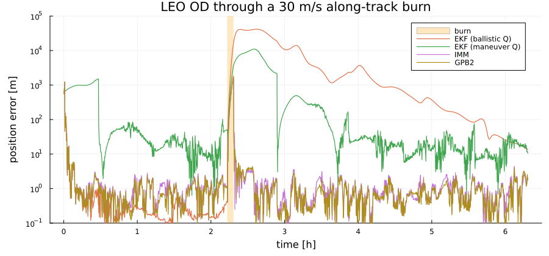
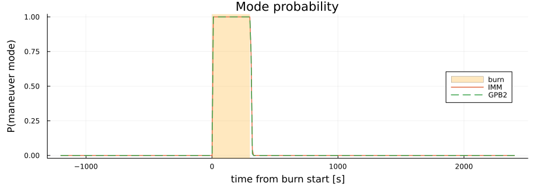
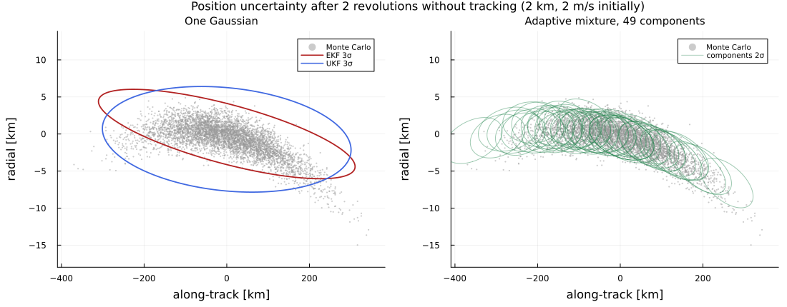
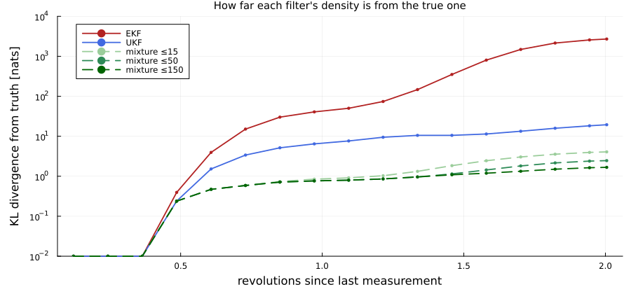
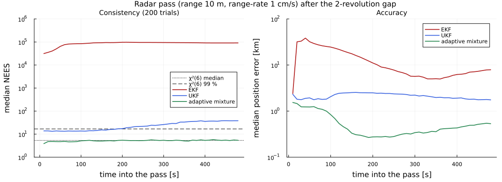
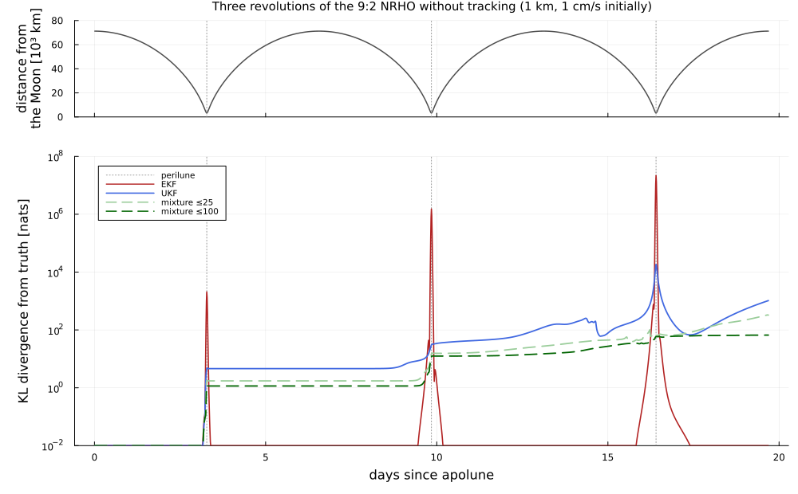
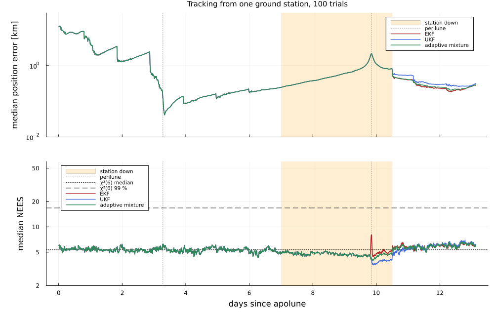

# EstimationToolkit.jl

[](https://github.com/OrbitAR7/EstimationToolkit.jl/actions/workflows/CI.yml)

Julia implementations of state estimation filters (Kalman and its square-root/information forms, EKF variants, sigma-point, ensemble, Gaussian-mixture, particle, multiple-model and grid-based filters) behind one `predict!`/`update!` interface, so they can be run side by side on the same problem.

I wrote this after my graduate estimation courses at UT Austin (ASE 381P.6 Statistical Estimation Theory and ASE 381P.7 Advanced Topics in Estimation Theory). I wanted one codebase where I could swap filters on the same dynamics and measurement model and see where each one breaks, especially on nonlinear and non-Gaussian problems like the ones in orbit determination. It's a research/learning codebase (v0.9), not flight software.

If you just need a fast, well-maintained KF/EKF/UKF/particle filter (or IMM), use [LowLevelParticleFilters.jl](https://github.com/baggepinnen/LowLevelParticleFilters.jl). What this package adds is the less common filters in one place with the same interface: GPB1/GPB2 and static multiple-model, particle flow (Daum-Huang, Gromov), the cubature/quadrature/divided-difference sigma-point filters, information-form filters and smoother, Gaussian sum and adaptive (splitting) Gaussian mixture filters, and point-mass grid filters.

Status: 37 filters (35 stable, 2 experimental grid-based ones) plus 2 smoothers, 869 tests. Requires Julia 1.10 or newer; CI runs on 1.10 and the latest release.

## Install

```julia
using Pkg
Pkg.add(url="https://github.com/OrbitAR7/EstimationToolkit.jl")
```

or, from a local clone, `Pkg.develop(path="path/to/EstimationToolkit.jl")`.

## Example

A constant-velocity target with position measurements. You define the model by subtyping `AbstractDynamicsModel{nx, nu, nw}` / `AbstractMeasurementModel{nx, nz, nv}` and adding methods for `propagate`, `process_noise_cov`, `measure` and `measurement_noise_cov`.

```julia
using EstimationToolkit
using LinearAlgebra, StaticArrays

struct ConstantVelocity <: AbstractDynamicsModel{4, 0, 4}
    q::Float64  # process noise intensity
end

function EstimationToolkit.propagate(m::ConstantVelocity, x, u, dt)
    F = @SMatrix [1.0 0.0  dt 0.0;
                  0.0 1.0 0.0  dt;
                  0.0 0.0 1.0 0.0;
                  0.0 0.0 0.0 1.0]
    return F * x
end

EstimationToolkit.process_noise_cov(m::ConstantVelocity, dt) =
    m.q * @SMatrix [dt^3/3 0 dt^2/2 0;
                    0 dt^3/3 0 dt^2/2;
                    dt^2/2 0 dt 0;
                    0 dt^2/2 0 dt]

struct PositionMeasurement <: AbstractMeasurementModel{4, 2, 2}
    r::Float64
end

EstimationToolkit.measure(m::PositionMeasurement, x) = x[1:2]
EstimationToolkit.measurement_noise_cov(m::PositionMeasurement) = m.r^2 * Matrix(1.0I, 2, 2)

x0 = @SVector [0.0, 0.0, 1.0, 0.5]   # [x, y, vx, vy]
P0 = SMatrix{4,4}(1.0I)

kf = KalmanFilter(x0, P0)
dyn = ConstantVelocity(0.1)
meas = PositionMeasurement(0.5)

for t in 1:100
    predict!(kf, dyn, nothing, 0.1)
    z = get_measurement(t)          # your measurement source
    update!(kf, meas, z)
    x̂, P = state_estimate(kf), covariance(kf)
end
```

Swapping in `UnscentedKalmanFilter`, `BootstrapParticleFilter`, etc. only changes the constructor line. NIS/NEES helpers (`nis`, `nees`, `consistency_test`) are included for checking filter consistency.

## Filters

| Family | Filters |
|---|---|
| Linear | `KalmanFilter`, `InformationFilter`, `SquareRootCovarianceFilter`, `SquareRootInformationFilter`, `FadingMemoryFilter` |
| Smoothers | `RauchTungStriebel`, `SquareRootInformationSmoother` |
| Extended | `ExtendedKalmanFilter`, `IteratedExtendedKalmanFilter`, `SecondOrderExtendedKalmanFilter` |
| Sigma-point | `UnscentedKalmanFilter`, `CubatureKalmanFilter`, `QuadratureKalmanFilter` (Gauss-Hermite), `DividedDifferenceFilter`, `CentralDifferenceKalmanFilter` |
| Ensemble | `EnsembleKalmanFilter`, `EnsembleTransformKalmanFilter`, `EnsembleSquareRootFilter` (with localization utilities) |
| Gaussian mixture | `GaussianSumFilter`, `EnsembleGMMFilter`, `AdaptiveGaussianMixtureFilter` (splits components during propagation) |
| Particle | `BootstrapParticleFilter`, `SequentialImportanceResampling`, `AuxiliaryParticleFilter`, `RegularizedParticleFilter`, `GaussianParticleFilter`, `ExtendedKalmanParticleFilter`, `UnscentedParticleFilter`, `RaoBlackwellizedParticleFilter`, `MarginalParticleFilter` |
| Particle flow | `GromovFlowFilter`, `DaumHuangFlowFilter` |
| Multiple model | `StaticMultipleModelFilter`, `InteractingMultipleModel`, `GPB1Filter`, `GPB2Filter` |
| Grid | `PointMassFilter`; `AdaptiveGridFilter` and `MarginalizedPointMassFilter` are experimental and can be numerically unstable |

Each filter's docstring (`?UnscentedKalmanFilter`) gives the reference it follows.

## Examples

The `examples/` folder has six scripts:

- `constant_velocity_tracking.jl`: `run_tracking_example()` runs KF, EKF, UKF and a particle filter on the same 2-D tracking problem.
- `filter_comparison.jl`: `compare_filters(nonlinearity=..., process_noise=..., meas_noise=...)` does a Monte Carlo comparison, and `run_nonlinearity_sweep()` / `run_noise_study()` sweep those settings.
- `orbit_determination.jl`: `run_orbit_determination()` estimates a planar orbit (polar coordinates r, ṙ, θ, θ̇) from range and range-rate at a ground station. It's a simplified 2-D problem, meant to compare filters, not a real OD setup.
- `orbit_maneuver_imm.jl`: maneuver detection, described below.
- `orbit_uncertainty.jl`: what a tracking gap does to a Gaussian, and what that does to the filter afterwards, described below.
- `nrho_navigation.jl`: the same question on a lunar near-rectilinear halo orbit, where the answer is different, described below. Needs [orbital-mechanics-jl](https://github.com/OrbitAR7/orbital-mechanics-jl).

### Maneuver detection in LEO

`examples/orbit_maneuver_imm.jl` simulates a 500 km circular orbit with an unannounced along-track burn (0.1 m/s² for 300 s, Δv = 30 m/s) at t = 8000 s. Tracking is range (10 m) and range-rate (1 mm/s) every 10 s from two GEO relays 180° apart, TDRS-style, so one is always in view. It's planar and point-mass gravity only, so the burn is the only thing the filters don't model. Four filters are compared, all EKF-based:

- EKF with ballistic process noise (≈1 µm/s² unmodeled acceleration)
- EKF with maneuver-level process noise (≈0.1 m/s²)
- IMM with both models
- GPB2 with both models

```
RMS position error [m]
filter           before    burn + 30 min      after
ekf_coast          0.27         35273.05    7299.10
ekf_burn          33.29          7795.26     745.70
imm                1.06           334.95       1.10
gpb2               0.91           334.91       0.93
```





The ballistic EKF is the best filter until the burn and then diverges to tens of km, because its covariance says it can't be wrong. The high-noise EKF survives the burn but is ~30x worse than the others the rest of the time; with only one relay's range and range-rate per epoch it depends heavily on the dynamics, and a large Q throws that away. IMM and GPB2 switch to the maneuver model within one measurement (10 s), switch back 20 s after the burn ends, never go above P = 0.013 outside the burn (no false alarms in this run), and are back to ~1 m afterwards. GPB2 (4 filters) and IMM (2 filters) give nearly the same answer here, which is the usual result and the reason IMM is the common choice.

Figures are made by `examples/plot_orbit_maneuver.jl` (needs Plots.jl, which isn't a package dependency).

### Non-Gaussian uncertainty after a tracking gap

`examples/orbit_uncertainty.jl` takes a satellite in a 700 km, 60° orbit that is known to 2 km and 2 m/s (1σ per axis) and leaves it untracked for two revolutions (3.3 h). The orbits inside that initial uncertainty have slightly different periods, so the uncertainty stretches to several hundred km along the track, and because the track is curved the stretched region is curved too. Dynamics are point-mass gravity plus J2 in 3-D. Truth and filters share the model and the integrator, so the only thing being tested is how each filter represents the uncertainty.



Three filters are compared: an EKF, a UKF, and `AdaptiveGaussianMixtureFilter`, which starts as a single Gaussian and splits a component in three when the dynamics have become too nonlinear over that component's extent. The trigger is the entropy criterion of DeMars, Bishop & Jah (2013), evaluated per step from the sigma points; the split keeps the mean and covariance of the mixture exactly. The docstring says where this differs from their AEGIS filter.

**Propagation only.** Each filter's predicted density q is scored against 20 000 Monte Carlo samples of the true distribution p by the Kullback-Leibler divergence, KL(p‖q) = −H(p) − E_p[log q]. These dynamics preserve phase-space volume, so the entropy H(p) of the true distribution stays at its initial value, which is known in closed form, and no density estimate of the cloud is needed. Zero means exact.

```
KL divergence from the true distribution [nats]
revolutions      EKF      UKF   mixture ≤15   mixture ≤50   mixture ≤150
0.5             0.39     0.24          0.24          0.24           0.24
1.0            40.71     6.45          0.85          0.76           0.76
1.5           351.41    10.54          1.84          1.14           1.09
2.0          2703.47    19.43          4.07          2.46           1.67
```



The means agree to within the Monte Carlo noise, so the first moment is not where the filters differ. Linearized propagation preserves volume just as the true flow does, so the EKF's ellipsoid stays as thin as the initial one while the true cloud bends out of it: after two revolutions the true samples are at a mean squared Mahalanobis distance of 5413 from the EKF's estimate, where 6 would mean the covariance fits. The UKF inflates its covariance to reach around the bend (38.8), which also puts probability where there is none. The mixture gives 6.1.

**A radar pass after the gap.** 200 Monte Carlo trials over the initial error. After the same two-revolution gap, a ground radar measures range (10 m) and range-rate (1 cm/s) every 10 s for one pass. NEES is the estimation error squared in units of the filter's own covariance; for a consistent 6-state filter it is χ²(6), with median 5.35 and 99 % of trials below 16.81.

```
           median position error [km]      median NEES              trials with NEES < 16.81
t [s]        EKF      UKF   mixture        EKF     UKF  mixture       EKF    UKF   mixture
10          2.39     2.32      1.54      31485    13.8      3.9        8%    62%       97%
60         29.36     1.77      1.25      76418    13.3      4.8        9%    63%       96%
120        21.76     2.44      0.54      88455    14.1      5.4        8%    63%       96%
240         8.26     2.42      0.27      95514    21.6      5.2        8%    43%       96%
480         7.89     1.75      0.53      90855    38.2      5.4        8%    34%       92%
```



The EKF applies a 10 m measurement to a prior that is far too thin, moves tens of km, and does not recover within the pass. The UKF's inflated prior keeps it within a couple of km, but its covariance is too small about a third to two thirds of the time and gets worse as the pass goes on. The mixture is 3 to 9 times more accurate than the UKF from two minutes in, and its NEES sits at the χ²(6) median. The mixture needs 14 to 24 components during the pass (it merges components that the measurements have made indistinguishable).

What this does not show:

- The mixture is not exact. Its KL divergence after two revolutions is 1.7 to 4 nats, not zero, and beyond about one revolution it is limited by the cap on the number of components, not by the split tolerance (tightening the tolerance from 0.05 to 0.002 nats changes the two-revolution figure by less than 0.3 nats at the same cap).
- It is slightly overconfident at the end of the pass: 92 % of trials inside the 99 % bound.
- It is not a real orbit determination setup: no process noise, no drag or higher-order gravity, a spherical Earth for the station, one station, one pass, no biases or light time, and the filter's dynamics are the truth's.
- It is not a reproduction of the AEGIS paper's numbers. The criterion is evaluated in discrete time, the split library is a moment-matching one I derived (in the `split_gaussian` docstring) and not their L2-optimal table, and the scenario is my own.

Figures are made by `examples/plot_orbit_uncertainty.jl`. The example itself runs in about 40 s.

### Where a Gaussian fails on a lunar halo orbit

`examples/nrho_navigation.jl` asks the same question in a different regime. The spacecraft is on the 9:2 near-rectilinear halo orbit (NRHO) of the Earth-Moon system, the orbit chosen for the lunar Gateway: 6.56 days per revolution, 71 000 km from the Moon at apolune and 3 200 km at perilune. The dynamics are the circular restricted three-body problem from my [orbital-mechanics-jl](https://github.com/OrbitAR7/orbital-mechanics-jl) package, which also computes the orbit from the mass ratio and supplies the state transition matrix the EKF uses as its Jacobian.

**Coasting.** A Gaussian of 1 km and 1 cm/s (1σ per axis) is propagated from apolune for three revolutions with no measurements, and scored against 3000 Monte Carlo samples by the same KL divergence as above (this flow preserves phase-space volume too).

```
KL divergence from the true distribution [nats], 0 = exact
                             EKF        UKF   mixture ≤25   mixture ≤100
perilune  day  3.28         2065        4.8           1.8            1.2
apolune   day  6.56         0.00        4.6           1.7            1.2
perilune  day  9.84      1.5e+06       35.3          15.8           12.6
apolune   day 13.12         0.00      123.9          27.6           15.0
perilune  day 16.41      2.2e+07      18395         101.7           59.2
apolune   day 19.69         0.00       1032         326.3           66.3
(perilune rows: largest value within six hours of perilune)

EKF more than 1 nat from the truth for 2.5 h, 9.0 h, 14.5 h around the successive perilunes; never elsewhere
largest EKF value more than a day from any perilune: 0.010 nats
```



This is the opposite of the low Earth orbit result, and I did not expect it.

- **Away from perilune the EKF is exact** to within the sampling noise, even after three revolutions. The flow from one apolune to the next is very nearly linear over this spread, and the EKF carries its covariance with the linearization of exactly that flow.
- **At perilune the EKF is badly wrong for a few hours.** The cloud is strung out along a path that bends tightly round the Moon while staying thin across it, and no ellipsoid in Cartesian coordinates describes it. The shape is transient: the flow is invertible, and the cloud straightens out again on the way back up.
- **The UKF and the mixture do better at perilune and worse ever after.** They re-fit their Gaussians to the cloud at every step. A moment-matched Gaussian has more volume than the bent cloud it was fitted to, and nothing later takes that volume out again. The UKF's inflation compounds at each perilune. The mixture loses less, but it loses.

So the mixture's split trigger, which measures nonlinearity step by step, cannot tell a bend that will undo itself from one that will not. In low Earth orbit the bend is permanent and splitting is the right response; here it is not. That is a limitation of the criterion (and of working in Cartesian coordinates), and the most useful thing this example taught me.

**Tracking.** 100 Monte Carlo trials of two revolutions tracked from one ground station (range 10 m, range-rate 1 mm/s every 10 minutes while above 10° elevation), with the station down from day 7.0 to day 10.5, across the second perilune. Truth and filters share the dynamics, including unmodelled accelerations of 1e-7 m/s².

```
                                   median position error [km]        median NEES (5.35)       NEES < 16.81 (99 %)
                                        EKF      UKF  mixture        EKF     UKF  mixture      EKF    UKF  mixture
before the outage, day 6.9            0.237    0.237    0.237        5.0      5.0      5.0       99%     99%     99%
perilune in the outage, day 9.85      2.153    2.163    2.163        8.1      4.1      4.2       67%     96%     97%
6 h after perilune                    0.961    0.965    0.965        4.9      3.9      4.6       99%     99%     99%
tracking again, day 11.0              0.398    0.532    0.406        5.6      5.6      5.7       98%    100%    100%
end, day 13.1                         0.281    0.313    0.290        6.0      6.2      6.2      100%    100%    100%

filter time for all trials [s]: EKF 3.2, UKF 5.9, mixture 34.6
```



With the station tracking, the three filters cannot be told apart: the uncertainty is small enough that the problem is linear. In the outage the EKF's covariance is too small at perilune (two thirds of trials inside the 99 % bound) and correct again six hours later without any help. When tracking resumes, the UKF is about 30 % less accurate than the other two for a day. The EKF costs a tenth of what the mixture does.

What this does not show:

- No measurement happens to be processed during the hours when the EKF's covariance is wrong (the station is down, and would not have been in view). An update or a manoeuvre planned at perilune from that covariance is where the EKF would be expected to do damage, and that case is not tested here.
- The UKF and mixture figures in the coast depend on the step length, because they re-fit at every step. The EKF's do not.
- The model is the circular restricted three-body problem with one station on a simplified Earth (equator in the Earth-Moon plane), no station-keeping burns, no solar gravity, and filter dynamics equal to the truth's. Burn execution errors are a major part of the real navigation problem on this orbit and are absent.

Figures are made by `examples/plot_nrho_navigation.jl`; the example runs in about two minutes.

## Tests and benchmarks

```julia
using Pkg
Pkg.test("EstimationToolkit")
```

869 tests: core 84, smoothers 156, grid 50, multiple model 115, advanced particle 123, particle flow/ensemble 40, log-space weights 31, adaptive Gaussian mixture 270. The multiple-model tests include reduction checks (with one mode, or with identical modes, IMM/GPB1/GPB2 must reproduce a plain Kalman filter exactly) and a 5000σ-innovation case that has to move the mode probabilities. The adaptive mixture tests check that a split preserves the mean and covariance (and, in 1-D, the moments up to the fifth), that on a linear system the filter never splits and reproduces the Kalman filter, and that on a nonlinear map the split mixture scores better against Monte Carlo samples than a single Gaussian. The weight tests use measurements for which every likelihood underflows to zero in floating point and require the posterior to be right anyway. Linear filters are checked against analytic solutions; the nonlinear and particle filters are checked on problems with known answers and for consistency. The grid tests only cover the stable filter.

Timing depends a lot on the machine and problem size, so I haven't put numbers here. `julia --project benchmark/benchmarks.jl` runs the benchmarks.

## Layout

```
src/
  core/              abstract types, interfaces, NIS/NEES diagnostics
  models/            dynamics/measurement model framework, linearization
  utils/             matrix helpers, statistics
  linear/ extended/ sigma_point/ ensemble/ particle/
  particle_flow/ gaussian_mixture/ multiple_model/ grid/
examples/  test/  benchmark/  docs/
```

Small states use StaticArrays. Covariance updates use stable forms where it matters (Joseph form, QR/Cholesky square-root updates).

## References

Most filters follow the course notes below, cited by chapter or section in each docstring. They're unpublished, so the textbook and paper references after them are the public sources for the same algorithms.

- T. Humphreys, *Statistical Estimation Theory* course notes, ASE 381P.6, The University of Texas at Austin, 2023.
- R. Zanetti, *Advanced Topics in Estimation Theory* class notes, Part 3 (Nonlinear Estimation of Nonlinear Systems) and Part 4 (Linear Filters), and lecture slides, ASE 381P.7, The University of Texas at Austin, Fall 2023. The ensemble Kalman filter slides are by A. A. Popov and R. Zanetti.
- Bar-Shalom, Li & Kirubarajan (2001), *Estimation with Applications to Tracking and Navigation*, Wiley.
- Simon (2006), *Optimal State Estimation: Kalman, H∞, and Nonlinear Approaches*, Wiley.
- Särkkä (2013), *Bayesian Filtering and Smoothing*, Cambridge University Press.
- Julier & Uhlmann (2004), "Unscented filtering and nonlinear estimation," *Proc. IEEE*.
- DeMars, Bishop & Jah (2013), "Entropy-based approach for uncertainty propagation of nonlinear dynamical systems," *J. Guidance, Control, and Dynamics* 36(4).
- Runnalls (2007), "Kullback-Leibler approach to Gaussian mixture reduction," *IEEE Trans. Aerospace and Electronic Systems* 43(3).
- Arulampalam et al. (2002), "A tutorial on particle filters for online nonlinear/non-Gaussian Bayesian tracking," *IEEE Trans. Signal Processing*.

## Citing

```bibtex
@software{alshammari_estimationtoolkit,
  author = {Alshammari, Hamoud},
  title  = {EstimationToolkit.jl},
  year   = {2026},
  url    = {https://github.com/OrbitAR7/EstimationToolkit.jl}
}
```

Bug reports and pull requests are welcome; see [CONTRIBUTING.md](CONTRIBUTING.md). MIT license.
