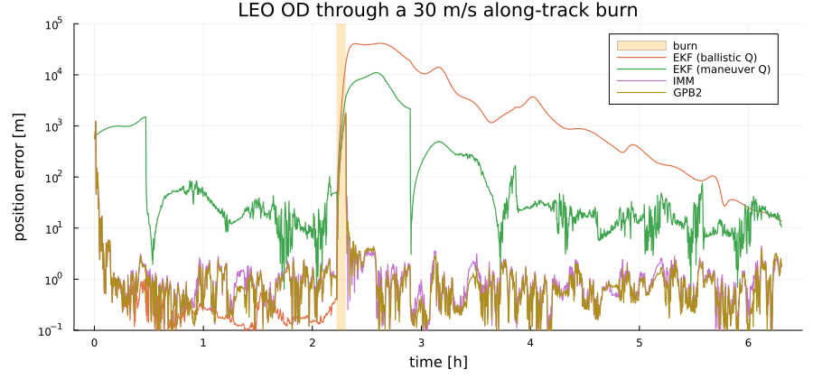
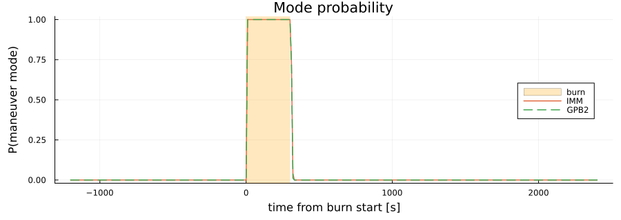

# EstimationToolkit.jl

[](https://github.com/OrbitAR7/EstimationToolkit.jl/actions/workflows/CI.yml)

Julia implementations of state estimation filters (Kalman and its square-root/information forms, EKF variants, sigma-point, ensemble, Gaussian-mixture, particle, multiple-model and grid-based filters) behind one `predict!`/`update!` interface, so they can be run side by side on the same problem.

I wrote this after my graduate estimation courses at UT Austin (ASE 381P.6 Statistical Estimation Theory and ASE 381P.7 Advanced Topics in Estimation Theory). I wanted one codebase where I could swap filters on the same dynamics and measurement model and see where each one breaks, especially on nonlinear and non-Gaussian problems like the ones in orbit determination. It's a research/learning codebase (v0.9), not flight software.

If you just need a fast, well-maintained KF/EKF/UKF/particle filter (or IMM), use [LowLevelParticleFilters.jl](https://github.com/baggepinnen/LowLevelParticleFilters.jl). What this package adds is the less common filters in one place with the same interface: GPB1/GPB2 and static multiple-model, particle flow (Daum-Huang, Gromov), the cubature/quadrature/divided-difference sigma-point filters, information-form filters and smoother, Gaussian sum, and point-mass grid filters.

Status: 36 filters (34 stable, 2 experimental grid-based ones) plus 2 smoothers, 568 tests. Requires Julia 1.10 or newer; CI runs on 1.10 and the latest release.

## Install

```julia
using Pkg
Pkg.add(url="https://github.com/OrbitAR7/EstimationToolkit.jl")
```

or, from a local clone, `Pkg.develop(path="path/to/EstimationToolkit.jl")`.

## Example

A constant-velocity target with position measurements. You define the model by subtyping `AbstractDynamicsModel{nx, nu, nw}` / `AbstractMeasurementModel{nx, nz, nv}` and adding methods for `propagate`, `process_noise_cov`, `measure` and `measurement_noise_cov`.

```julia
using EstimationToolkit
using LinearAlgebra, StaticArrays

struct ConstantVelocity <: AbstractDynamicsModel{4, 0, 4}
    q::Float64  # process noise intensity
end

function EstimationToolkit.propagate(m::ConstantVelocity, x, u, dt)
    F = @SMatrix [1.0 0.0  dt 0.0;
                  0.0 1.0 0.0  dt;
                  0.0 0.0 1.0 0.0;
                  0.0 0.0 0.0 1.0]
    return F * x
end

EstimationToolkit.process_noise_cov(m::ConstantVelocity, dt) =
    m.q * @SMatrix [dt^3/3 0 dt^2/2 0;
                    0 dt^3/3 0 dt^2/2;
                    dt^2/2 0 dt 0;
                    0 dt^2/2 0 dt]

struct PositionMeasurement <: AbstractMeasurementModel{4, 2, 2}
    r::Float64
end

EstimationToolkit.measure(m::PositionMeasurement, x) = x[1:2]
EstimationToolkit.measurement_noise_cov(m::PositionMeasurement) = m.r^2 * Matrix(1.0I, 2, 2)

x0 = @SVector [0.0, 0.0, 1.0, 0.5]   # [x, y, vx, vy]
P0 = SMatrix{4,4}(1.0I)

kf = KalmanFilter(x0, P0)
dyn = ConstantVelocity(0.1)
meas = PositionMeasurement(0.5)

for t in 1:100
    predict!(kf, dyn, nothing, 0.1)
    z = get_measurement(t)          # your measurement source
    update!(kf, meas, z)
    x̂, P = state_estimate(kf), covariance(kf)
end
```

Swapping in `UnscentedKalmanFilter`, `BootstrapParticleFilter`, etc. only changes the constructor line. NIS/NEES helpers (`nis`, `nees`, `consistency_test`) are included for checking filter consistency.

## Filters

| Family | Filters |
|---|---|
| Linear | `KalmanFilter`, `InformationFilter`, `SquareRootCovarianceFilter`, `SquareRootInformationFilter`, `FadingMemoryFilter` |
| Smoothers | `RauchTungStriebel`, `SquareRootInformationSmoother` |
| Extended | `ExtendedKalmanFilter`, `IteratedExtendedKalmanFilter`, `SecondOrderExtendedKalmanFilter` |
| Sigma-point | `UnscentedKalmanFilter`, `CubatureKalmanFilter`, `QuadratureKalmanFilter` (Gauss-Hermite), `DividedDifferenceFilter`, `CentralDifferenceKalmanFilter` |
| Ensemble | `EnsembleKalmanFilter`, `EnsembleTransformKalmanFilter`, `EnsembleSquareRootFilter` (with localization utilities) |
| Gaussian mixture | `GaussianSumFilter`, `EnsembleGMMFilter` |
| Particle | `BootstrapParticleFilter`, `SequentialImportanceResampling`, `AuxiliaryParticleFilter`, `RegularizedParticleFilter`, `GaussianParticleFilter`, `ExtendedKalmanParticleFilter`, `UnscentedParticleFilter`, `RaoBlackwellizedParticleFilter`, `MarginalParticleFilter` |
| Particle flow | `GromovFlowFilter`, `DaumHuangFlowFilter` |
| Multiple model | `StaticMultipleModelFilter`, `InteractingMultipleModel`, `GPB1Filter`, `GPB2Filter` |
| Grid | `PointMassFilter`; `AdaptiveGridFilter` and `MarginalizedPointMassFilter` are experimental and can be numerically unstable |

Each filter's docstring (`?UnscentedKalmanFilter`) gives the reference it follows.

## Examples

The `examples/` folder has three scripts:

- `constant_velocity_tracking.jl`: `run_tracking_example()` runs KF, EKF, UKF and a particle filter on the same 2-D tracking problem.
- `filter_comparison.jl`: `compare_filters(nonlinearity=..., process_noise=..., meas_noise=...)` does a Monte Carlo comparison, and `run_nonlinearity_sweep()` / `run_noise_study()` sweep those settings.
- `orbit_determination.jl`: `run_orbit_determination()` estimates a planar orbit (polar coordinates r, ṙ, θ, θ̇) from range and range-rate at a ground station. It's a simplified 2-D problem, meant to compare filters, not a real OD setup.
- `orbit_maneuver_imm.jl`: maneuver detection, described below.

### Maneuver detection in LEO

`examples/orbit_maneuver_imm.jl` simulates a 500 km circular orbit with an unannounced along-track burn (0.1 m/s² for 300 s, Δv = 30 m/s) at t = 8000 s. Tracking is range (10 m) and range-rate (1 mm/s) every 10 s from two GEO relays 180° apart, TDRS-style, so one is always in view. It's planar and point-mass gravity only, so the burn is the only thing the filters don't model. Four filters are compared, all EKF-based:

- EKF with ballistic process noise (≈1 µm/s² unmodeled acceleration)
- EKF with maneuver-level process noise (≈0.1 m/s²)
- IMM with both models
- GPB2 with both models

```
RMS position error [m]
filter           before    burn + 30 min      after
ekf_coast          0.27         35273.05    7299.10
ekf_burn          33.29          7795.26     745.70
imm                1.06           334.95       1.10
gpb2               0.91           334.91       0.93
```





The ballistic EKF is the best filter until the burn and then diverges to tens of km, because its covariance says it can't be wrong. The high-noise EKF survives the burn but is ~30x worse than the others the rest of the time; with only one relay's range and range-rate per epoch it depends heavily on the dynamics, and a large Q throws that away. IMM and GPB2 switch to the maneuver model within one measurement (10 s), switch back 20 s after the burn ends, never go above P = 0.013 outside the burn (no false alarms in this run), and are back to ~1 m afterwards. GPB2 (4 filters) and IMM (2 filters) give nearly the same answer here, which is the usual result and the reason IMM is the common choice.

Figures are made by `examples/plot_orbit_maneuver.jl` (needs Plots.jl, which isn't a package dependency).

## Tests and benchmarks

```julia
using Pkg
Pkg.test("EstimationToolkit")
```

568 tests: core 84, smoothers 156, grid 50, multiple model 115, advanced particle 123, particle flow/ensemble 40. The multiple-model tests include reduction checks (with one mode, or with identical modes, IMM/GPB1/GPB2 must reproduce a plain Kalman filter exactly) and a 5000σ-innovation case that has to move the mode probabilities. Linear filters are checked against analytic solutions; the nonlinear and particle filters are checked on problems with known answers and for consistency. The grid tests only cover the stable filter.

Timing depends a lot on the machine and problem size, so I haven't put numbers here. `julia --project benchmark/benchmarks.jl` runs the benchmarks.

## Layout

```
src/
  core/              abstract types, interfaces, NIS/NEES diagnostics
  models/            dynamics/measurement model framework, linearization
  utils/             matrix helpers, statistics
  linear/ extended/ sigma_point/ ensemble/ particle/
  particle_flow/ gaussian_mixture/ multiple_model/ grid/
examples/  test/  benchmark/  docs/
```

Small states use StaticArrays. Covariance updates use stable forms where it matters (Joseph form, QR/Cholesky square-root updates).

## References

Most filters follow the course notes below, cited by chapter or section in each docstring. They're unpublished, so the textbook and paper references after them are the public sources for the same algorithms.

- T. Humphreys, *Statistical Estimation Theory* course notes, ASE 381P.6, The University of Texas at Austin, 2023.
- R. Zanetti, *Advanced Topics in Estimation Theory* class notes, Part 3 (Nonlinear Estimation of Nonlinear Systems) and Part 4 (Linear Filters), and lecture slides, ASE 381P.7, The University of Texas at Austin, Fall 2023. The ensemble Kalman filter slides are by A. A. Popov and R. Zanetti.
- Bar-Shalom, Li & Kirubarajan (2001), *Estimation with Applications to Tracking and Navigation*, Wiley.
- Simon (2006), *Optimal State Estimation: Kalman, H∞, and Nonlinear Approaches*, Wiley.
- Särkkä (2013), *Bayesian Filtering and Smoothing*, Cambridge University Press.
- Julier & Uhlmann (2004), "Unscented filtering and nonlinear estimation," *Proc. IEEE*.
- Arulampalam et al. (2002), "A tutorial on particle filters for online nonlinear/non-Gaussian Bayesian tracking," *IEEE Trans. Signal Processing*.

## Citing

```bibtex
@software{alshammari_estimationtoolkit,
  author = {Alshammari, Hamoud},
  title  = {EstimationToolkit.jl},
  year   = {2026},
  url    = {https://github.com/OrbitAR7/EstimationToolkit.jl}
}
```

Bug reports and pull requests are welcome; see [CONTRIBUTING.md](CONTRIBUTING.md). MIT license.
